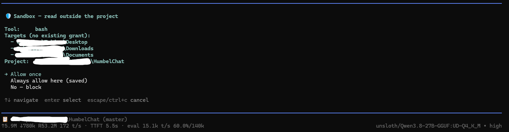
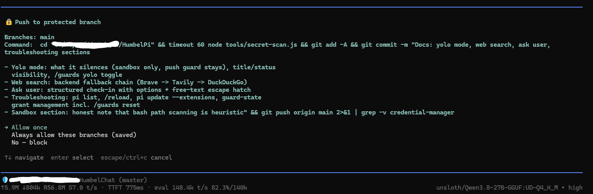
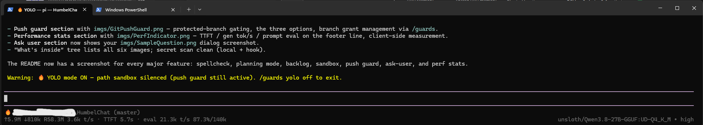
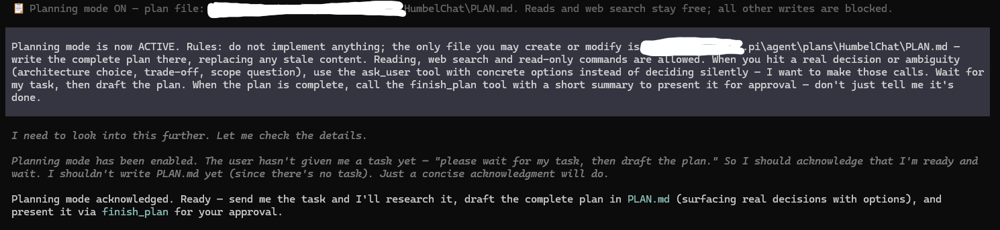
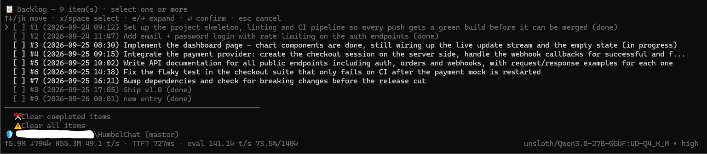
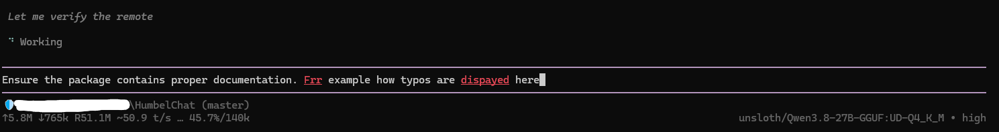
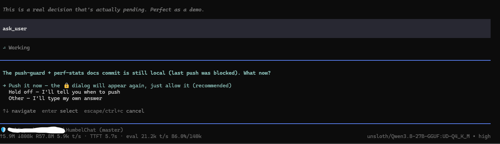

# HumbelPi

Personal [pi coding agent](https://github.com/badlogic/pi-mono) setup, distributed as a
[pi package](https://github.com/badlogic/pi-mono/blob/main/packages/coding-agent/docs/packages.md).
Everything here is **extensions** — the pi installation itself is never modified.

What you get:

- 🔒 **Guards** — a path sandbox and a git push guard gate risky operations with
  permission dialogs ([file access](#sandbox--file-access-outside-the-project),
  [push guard](#push-guard))
- 🔥 **Yolo mode** — silence the path sandbox; a machine-wide setting that sticks
  until you toggle it, on by default inside sandboxes ([yolo mode](#yolo-mode))
- 🌙 **Unattended mode** — `/away [instruction]` keeps the agent working while you're
  away, dialogs auto-reject ([unattended mode](#unattended-mode))
- 📋 **Planning mode** — plan first, approve via dialog, then implement with progress
  reporting ([planning mode](#planning-mode))
- ✅ **Backlog** — a multi-select task checklist with plan/implement/done actions
  ([backlog](#backlog))
- 🖱️ **Shift select** — standard shift+arrow text selection with clipboard copy in the
  input editor, where pi's shift keys are dead by default ([shift select](#shift-select))
- ✍️ **Spellcheck** — live typo highlighting while you type ([spellcheck](#spellcheck))
- 🔎 **Web search**, 💬 **ask_user** dialogs, 📈 **perf stats** in the footer

Two ways to run it: plainly on your machine (install below), or — recommended — inside
a real sandbox with one command: [Real sandbox (sbxpi)](#real-sandbox-docker-sandboxes-sbx).

## Getting started

```bash
# 1. pi itself (pristine, unmodified)
npm i -g @earendil-works/pi-coding-agent

# 2. this package
pi install git:github.com/MeleeCampz/HumbelPi
```

That's it — the extensions load into every pi session on this machine.

## ⚠️ The guards are not a real sandbox

The path sandbox in `guards.ts` is a **heuristic**. It scans bash commands token by
token and checks tool paths against the project root — it is a guardrail against
accidents, **not a security boundary**.

It can be bypassed, intentionally or not:

- shell variables and expansion (`$HOME`, `$(…)`, backticks), encoded or indirect
  commands, and anything that builds a path at runtime;
- creating a brand-new directory tree *outside* the project (nothing exists yet,
  so there is nothing to detect);
- any tool or code path that isn't inspected token-by-token.

**If you work with untrusted content, very capable models, or unattended runs —
run pi inside a proper sandbox:** a microVM (Docker Sandboxes, Firecracker & co.),
a VM, or at least strict OS-level user/permissions. The guards then become a
second layer of convenience on top of a real boundary, not the boundary itself.

Note: **a plain Docker container is NOT a real sandbox** — it only isolates via
namespaces and cgroups on the *shared host kernel*, so a kernel exploit can escape
it. MicroVMs (like Docker Sandboxes) give each sandbox its own kernel; that is what
makes them a real boundary.

This repo ships exactly that: [Real sandbox (Docker Sandboxes / sbx)](#real-sandbox-docker-sandboxes-sbx)
— one command, pi running in a microVM with HumbelPi installed inside.

## Real sandbox (Docker Sandboxes / sbx)

[The guards](#-the-guards-are-not-a-real-sandbox) are a guardrail. For a real
boundary, `tools/sbx-pi.sh` runs pi inside a
[Docker Sandboxes](https://docs.docker.com/ai/sandboxes/) **microVM** — one
command from any folder:

```bash
cd /path/to/any/project
sbxpi
```

`sbxpi` is a self-locating shim from the repo's `bin/` directory (setup in
[docs/sbxpi.md](docs/sbxpi.md)) that launches `tools/sbx-pi.sh`, which:

1. Creates a sandbox from Docker's official pi kit (`docker.io/sbx/pi-kit:latest`),
   with `HUMBLE_PI_YOLO=1` baked in so yolo mode is on by default inside (see
   [Yolo mode](#yolo-mode)) — or reuses the existing one for this folder (sandboxes
   are named `pi-<folder>`).
2. Mounts two things into the microVM: your current folder as a **read-write
   workspace**, and this repo **read-only**.
3. Wires your local model: copies **every locally hosted provider** from your
   host's `~/.pi/agent/models.json` into the sandbox (baseUrl host rewritten to
   `host.docker.internal`, port/path kept — e.g. `http://host.docker.internal:8889/v1`
   for Strata) and sets a default model — `strata` if defined, else
   `unsloth-studio` —
   merged into `settings.json`, so installed packages and preferences survive
   re-provisioning. Sandboxes deliberately don't import user-level `~/.pi`
   config, so this step exists.
4. Installs HumbelPi from the read-only mount — guards, backlog, `/away`, perf stats
   and friends run **inside** the VM, as a second layer on top of the real boundary.
5. Drops you into pi's TUI, already on your model — and **continues your last
   session** in that folder (`pi --continue`). With no prior session it simply
   starts fresh; `sbxpi --new` always starts a fresh one.

### Setup & day-to-day

Requirements in short: the standalone [`sbx` CLI](https://docs.docker.com/ai/sandboxes/install/)
(signed in — **no Docker Desktop needed**, sbx ships its own microVM runtime),
bash + Node.js, and `<this repo>\bin` on your PATH so `sbxpi` works in any
terminal on any OS.

Full one-time setup (per OS), the sandbox management commands (`sbx ls / run /
stop / rm / prune`) and sbxpi-specific notes/gotchas live in
[**docs/sbxpi.md**](docs/sbxpi.md) — for how Docker Sandboxes itself works, see
the [official docs](https://docs.docker.com/ai/sandboxes/).

## Sandbox — file access outside the project



- Any tool call touching a path **outside the project** is gated by this dialog before
  it runs.
- The dialog shows: tool name, target(s) with their current setting (`no grant` /
  `read-only — writes ask`), the project root, and a consequence note where relevant.
- Options depend on the request and existing grants:
  - read, no grant: `Allow once` · `Always allow here (saved)` · `No — block`
  - write, no grant: adds `Read-only here (writes still ask, saved)`
  - write into a read-only area: `Allow this write once` · `Upgrade to full access (saved)`
    · `Keep read-only — block this write`
- Saved options persist per machine in `~/.pi/agent/guard-state.json`; "Allow once" is
  one-shot; blocking aborts the tool call immediately.
- Honest limitation: bash commands are scanned *heuristically* for the paths they
  touch — the sandbox is a guardrail, not a hard boundary. See
  [⚠️ The guards are not a real sandbox](#-the-guards-are-not-a-real-sandbox) —
  for real isolation, use the [Docker Sandboxes setup above](#real-sandbox-docker-sandboxes-sbx).

## Push guard



- `git push` landing on a protected branch (`main` / `master`) is gated by this dialog;
  feature branches pass silently.
- Options: `Allow once` · `Always allow these branches (saved)` · `No — block`. Saved
  branches persist in `~/.pi/agent/guard-state.json`; manage them with
  `/guards allow-branch <name>` / `/guards revoke-branch <name>`.

## Yolo mode



- 🔥 YOLO mode silences the path sandbox — tool calls no longer ask about paths
  outside the project. The **push guard stays active**. It is a **machine-wide setting**
  (unlike planning and unattended mode, which are per console): state lives in
  `~/.pi/agent/guard-state.json`, so a toggle sticks until you explicitly change it —
  across sessions, sandbox restarts, `/new` and `/resume`. It can no longer flip off
  by accident when pi starts a fresh session (#14).
- **Default ON in sandboxes**: yolo defaults on whenever a sandbox is detected —
  `HUMBLE_PI_YOLO=1` (baked into every `sbxpi` sandbox at create time), the
  `SANDBOX_NAME` env var docker-sandboxes sets, or `/run/sandbox` on disk. In a proper
  sandbox the container IS the isolation boundary, so the path guard would only add
  noise — and old sandboxes created before the env var existed are covered by the
  other two signals. Outside a sandbox the default is off, guards fully active.
  A `/guards yolo off` (or `on`) sets it explicitly and keeps winning; `/guards`
  status shows whether the active value is `(set)` or a `(default: …)`.
- The state is visible at all times in the window title (`🔥 YOLO — pi — <dir>`) and
  in the `/guards` status line, so you always know it's on.
- Toggle: `/guards yolo on | off`.

## Unattended mode

- For when you step away and want the agent to keep working: `/away [instruction]`
  turns unattended mode on and immediately hands your instruction to the agent as its
  next message. If a run is already active, the instruction **steers** that run —
  delivered before the agent's next LLM call so it can redirect immediately instead
  of finishing the old task first. Bare `/away` turns it off.
- While on, **every confirmation dialogue is auto-rejected instead of hanging**: the
  sandbox path dialog, the push guard, `ask_user`, and the `finish_plan` approval all
  decline automatically, and each rejection tells the model to pick the safest reasonable
  option and record it in a "Decisions made while unattended" section of its final report.
- Every user message also carries an `[UNATTENDED MODE]` frame so the model knows you are
  away and should not wait for input — when it runs out of safe work it ends its turn
  with a summary instead of blocking.
- **Per console**: unattended state lives in `~/.pi/agent/session-state/<session>.json`,
  so other pi consoles on the same machine are unaffected; resuming the same session
  keeps it, new sessions start clean. YOLO silencing still wins — ops yolo already
  silences never reach a dialog and keep passing silently.
- Visible in the window title (`🌙 AWAY — pi — <dir>`, combines with 🔥/📋), the footer
  marker, and the `/guards` status line.

## Planning mode



- Enter with `/plan on [task]` — one step: opens planning mode and hands the task
  over as the plan's starting point.
- **Per console**: plan state lives in `~/.pi/agent/session-state/<session>.json`, so
  other pi consoles on the same machine are unaffected; resuming a session keeps its
  plan, new sessions start clean.
- While active, only the plan file is writable: `<project>/.pi/PLAN.md` (in the
  project, gitignored, next to the backlog — easy to access even when pi runs in a
  VM); reads and searches stay free.
- The finished plan is presented via the **finish_plan** dialog — "✅ Approve & implement"
  starts implementation immediately; "✏️ Keep planning" asks for a short refusal reason
  that is fed back to the agent. The reason box is **not** a dead end (#3): `esc` there puts
  you back on Approve / Keep planning with what you typed kept, so you can still approve;
  `ctrl+c` is the deliberate cancel. Same flow as `ask_user` (shared `extensions/lib/ask-loop.ts`).
- Planning state also syncs into the window title, so it's visible at a glance.

## Backlog



- Bare `/backlog` opens the project's task list (`.pi/backlog.md`) as a multi-select
  checklist; `/backlog <idea>` appends a new item.
- Navigate with ↑↓ / `j` `k`, toggle items with `x` or space, ⏎ confirms the selection,
  esc cancels. Long items expand inline with `e` or → (word-wrapped full text);
  several can be open at once.
- After confirming, pick an action for the selected items: **plan** (hands them to
  planning mode), **implement**, **mark done**, or **delete** — plus bottom rows for
  clearing completed / all entries.
- Status markers per item: `[ ]` open, `[~]` in progress, `[x]` done (rendered dimmed).

## Shift select

`select-editor.ts` replaces pi's editor with a subclass that turns the input into a
normal text editor for selection: pi's shift+arrow keys are dead by default, this makes
them select text — and lets you copy it to the system clipboard. It composes with
spellcheck (it extends the spellchecking editor, so typo highlighting keeps working).

- **Select:** hold `Shift` + `← → ↑ ↓ Home End` to extend the selection from the caret;
  `Ctrl+Shift+←/→` jumps by words. The selected range is drawn with a gray background
  and a `⬒ N` character-count indicator on the editor's bottom border.
- **Copy:** `Shift+Insert`, `Ctrl+Shift+C`, or plain `Ctrl+C` while a selection exists
  (without a selection `Ctrl+C` still does pi's normal thing — double-Ctrl+C to clear).
- **Select all:** `Ctrl+A`. Note this is repurposed from pi's stock "jump to line start";
  `/select off` restores the stock binding.
- **Editing with a selection:** standard semantics — typing, `Backspace` or `Delete`
  replaces the selected text (with two-step undo: first `Ctrl+Z` restores the deleted
  range, second restores everything). Plain arrows collapse to the edge in the pressed
  direction; any other key just clears the selection.
- Works on wrapped lines and with emoji/multi-byte input (grapheme-aware — the caret
  movement is pi's own engine; the extension only tracks the selection endpoints).
- Toggle: `/select on | off | status` — **on by default**, persisted in the guard state,
  re-applied automatically on every session start.

## Spellcheck

`spellcheck.ts` replaces pi's editor with a subclass that highlights likely typos
**live, in place, while you type** — red + underlined, like a web form. No prompts,
no post-enter confirmation: the text is sent exactly as typed.



- Works **everywhere you type free text**: the main editor, slash-command arguments
  (e.g. `/backlog <idea>`, `/plan reject [reason]`) and the free-text dialogs — the
  `ask_user` “Other” answer and the plan-feedback input (“✏️ Keep planning”).
- Dictionary: `extensions/words-en.txt` (~370k words, bundled); personal additions go
  to `~/.pi/agent/spell-ignore.txt` (one word per line — names, identifiers, project terms).
- Skipped: slash command names, CamelCase / ALLCAPS tokens, words with digits or symbols,
  words ≤ 2 letters.
- Toggle: `/spellcheck on | off | status`.

## Ask user



- The `ask_user` tool lets the agent check in before making an important assumption:
  it presents a list of concrete options plus a free-text "Other" escape hatch. Your
  answer comes back as the tool result and the agent proceeds with exactly that.
- Keys in the answer box: `enter` submits, **`esc` goes back to the option list** with what
  you typed kept as a draft (change your mind without losing anything, then pick a preset),
  `ctrl+c` cancels the question outright. In the option list itself `enter` picks and
  `esc`/`ctrl+c` dismiss. In non-TUI modes (rpc/print) type `!back` or `!cancel` instead.
- Loop + tests: `extensions/lib/ask-loop.ts` (pure) / `extensions/lib/ask-flow.ts` (ctx.ui
  wiring); regression test `tools/test-ask-flow.ts` (`npx tsx tools/test-ask-flow.ts`).

## Web search

- Registers a `web_search` tool in every project.
- Backends are tried in order: `BRAVE_API_KEY` (Brave Search API) →
  `TAVILY_API_KEY` (Tavily) → DuckDuckGo HTML (no key required).
- For full page content after a search, the agent just curls the URL.

## Performance stats


- Per-LLM-call stats on the footer's model info line — no extra console lines.
- **TTFT**: request → first content delta; **gen tok/s**: output tokens / streaming
  time (live estimate while streaming); **prompt eval**: blended prefill speed, shown
  when possible.
- Measured client-side from pi's events — providers don't report server-side timing.

## What's inside

```
extensions/
  guards.ts        sandbox + git-push guard, yolo mode, unattended mode (/away [instruction]),
                   planning mode (/plan on [task]), per-group permission dialogs,
                   custom footer (perf stats), title sync
  backlog.ts       /backlog checklist: multi-select + actions (plan/implement/done/delete/clear)
  perf-stats.ts    tok/s + TTFT measured client-side, shown in the footer
  working-task.ts  working_task tool — model sets/clears the current task in the working indicator
                   (pi keeps the text across runs, so it is cleared when a new prompt starts one — #1)
  select-editor.ts shift+arrow text selection + clipboard copy in the input (/select)
  spellcheck.ts    spelling checks for user messages (dictionary: extensions/words-en.txt)
  web-search.ts    web search tool
  ask-user.ts      structured ask_user dialog
  done-notify.ts   finish/waiting notifications: terminal toast + bell, Home Assistant push
                   when pi needs you and you are not at the machine (/notify)
.githooks/pre-push   secret scan that runs on every push (this repo is public)
bin/
  sbxpi, .ps1, .cmd  PATH launcher shims — `sbxpi` in any terminal/OS
docs/
  sbxpi.md           sbxpi setup (per OS), sandbox management, gotchas
tools/
  sbx-pi.sh          one-command sandbox launcher — see "Real sandbox" above
  sbx-local-model.sh wires a sandbox's pi to the host's local model
  test-*.ts          regression tests — npx tsx tools/test-ask-flow.ts |
                     test-backlog-scroll.ts (needs pi's own node_modules on NODE_PATH) |
                     test-yolo.ts | test-secret-scan.ts
```

## Development on a machine that uses this repo directly

Install with a local path instead of git — pi loads the extensions in place, so
editing a file here and restarting pi is the whole dev loop:

```bash
pi install ./path/to/HumbelPi
```

The `pre-push` hook (`.githooks/pre-push`, enabled per clone via
git config core.hooksPath .githooks) runs tools/secret-scan.js on every push:
API keys, non-placeholder apiKey values, PEM private keys, Bearer tokens,
user-specific paths. It aborts the push if anything looks private.

It scans **what a push can actually carry** — the index, plus untracked files that are not
gitignored (one `git add -A` away from being public) — rather than the whole working tree.
pi writes plan and session files under `.pi/` that legitimately contain your own
`C:\Users\…` paths and are never pushed, so a filesystem-wide scan aborted *every* push on a
false positive. Audit ignored files deliberately with `node tools/secret-scan.js --all`.
Regression test: `tools/test-secret-scan.ts`.

## Notifications: "it's done" and "it needs me"

`done-notify.ts` adds `/notify status | services | on | off | test [text]` and fires two tiers:

```
local   every run end, and every time a dialog opens: OSC 9 → Windows Terminal raises a native
        toast, then BEL → tab + taskbar flash, plus a sound if your profile allows it
        (Windows Terminal settings.json: "bellNotification": "all"). They are just bytes on
        stdout, so they survive sbxpi too: the container's pi writes into the same WT window.
remote  one POST to Home Assistant's notify service, so the ping reaches your phone / dashboard
        / TTS / lights when you are not at this machine.
```

When the phone is buzzed — the whole point is not to buzz you for work you are watching: always
when pi is blocked on you (a guards approval, a /plan question, an ask_user), otherwise only for
a run longer than `HUMBLE_PI_NOTIFY_LONG_RUN_S` (90s) when nobody has typed in this session for
`HUMBLE_PI_NOTIFY_IDLE_S` (30s). pi enables terminal focus reporting (?1004h) but never tells
extensions whether the window is focused, so presence is measured by the last human-typed
message. That is a proxy, not a sensor — said out loud rather than hidden in a flag.

Config lives in your PowerShell profile (`$PROFILE`), not in this repo:

```powershell
$env:HUMBLE_PI_HA_URL     = "http://homeassistant.local:8123"
$env:HUMBLE_PI_HA_TOKEN   = "…"   # HA long-lived token (profile → Security). Never committed.
$env:HUMBLE_PI_HA_SERVICE = "notify.mobile_app_<your_device>"   # exactly what /notify services prints first
$env:HUMBLE_PI_NOTIFY_LONG_RUN_S = "90"  # 0 disables the duration rule
$env:HUMBLE_PI_NOTIFY_IDLE_S     = "30"  # 0 disables the presence heuristic
$env:HUMBLE_PI_NOTIFY_MIN_RUN_S  = "0"   # skip the toast for trivially short runs
$env:HUMBLE_PI_NOTIFY_LOCAL      = "osc9,bell"
$env:HUMBLE_PI_NOTIFY_REMOTE     = "1"   # 0 = terminal only
$env:HUMBLE_PI_HA_EXTRA          = '{"data":{"tag":"pi","group":"pi"}}'  # raw JSON merged in the payload
```

Those reach a **native** `pi`. They do not reach a sandbox: a container's environment is fixed at
`sbx create`, so `HUMBLE_PI_HA_*` you set in your profile afterwards — or on a host other than the
one the sandbox was created from — are not inside it, and the only thing you get is "not configured",
which reads like a broken extension rather than a frozen environment. So config may also come from a
file the extension reads itself:

```text
$HOME/.pi/agent/notify.env        # same KEY=value syntax, # comments, quotes allowed
$env:HUMBLE_PI_HA_ENV_FILE        # move it anywhere
```

Only `HUMBLE_PI_*` keys are read from it — a config file that could also set `PATH` would be a worse
bug than the one it fixes. Real environment variables always beat the file, so a one-off
`HUMBLE_PI_HA_SERVICE=… pi` still wins, and `/notify status` names the file it read and which keys
came from it. `tools/sbx-pi.sh` writes that file into the sandbox on every launch from whatever the
host has: it echoes key names only (never the token), and refuses any value containing shell
metacharacters, because those values are interpolated into a command executed inside the container.

Leave `HUMBLE_PI_HA_SERVICE` unset and the target is `persistent_notification.create`: it exists on
every install, always accepts `{title, message}`, and never fails — but it lands in HA's own
notification tray and will never buzz a phone, and `/notify status` says so instead of letting you
assume otherwise. `notify.notify` is deliberately *not* the default: HA describes it as shorthand
for "the first notify thing I can find", it is integration-specific, and current versions can fail
it outright (core#111015). One more way to earn a 400: `persistent_notification.create` accepts only
`title`, `message`, `notification_id`, so do not send `HUMBLE_PI_HA_EXTRA` at it.

`/notify test` sends one of each and reports what happened; `/notify services` asks your HA which
services it actually accepts and prints the exact `HUMBLE_PI_HA_SERVICE` value to use — useful
because HA's failure codes are precise about what you got wrong:

```
401  token wrong or expired          404  that service does not exist
400  the service exists but {title, message} does not fit its schema
```

The call is `POST <HUMBLE_PI_HA_URL>/api/services/<domain>/<service>` — HA's REST route is
`domain.service` → `domain/service`, **not** a trailing `/notify` (that shape answers 404; it is
what my first version did, caught by probing a real instance). To check the
terminal half without pi running:

```powershell
Write-Host "$([char]27)]9;hello from pi$([char]7)"   # toast
Write-Host "$([char]7)"                              # bell (tab + taskbar flash)
```

Running pi in the sandbox: the container has to reach HA, so allow the HA host in the sandbox
network policy and pass the token as container env (`-e HUMBLE_PI_HA_TOKEN=…`) instead of putting
it in a file. A remote tier that cannot reach HA reports the failure in `/notify status` and
never blocks or fails a run. Tests: `tools/test-done-notify.ts` (59 checks — policy decisions,
terminal-safety of model-supplied text, the HA request shape, and a self-scan so its own fake token
can never be re-written as a literal) and press scenarios k/l/m (real pi in a PTY against a
HA-shaped fake that answers 404 off-route and 401 without a token: k proves the dialog ping and that
a finished run buzzes when the heuristic is off; l proves the same finished run stays off the phone
when you typed seconds ago; m proves `/notify services` reads the instance's real registry).

## Troubleshooting

- `pi list` — shows installed packages and where they resolve to.
- `/reload` — reload extensions/settings after manual edits.
- `pi update --extensions` — reconcile package installs (pulls new commits from a git source).
- Grants live in `~/.pi/agent/guard-state.json`. `/guards` shows the full status;
  individual grants are managed with `/guards allow-path|revoke-path|allow-ro-path|
  revoke-ro-path|allow-branch|revoke-branch`, and `/guards reset` clears everything
  and re-enables both guards.
